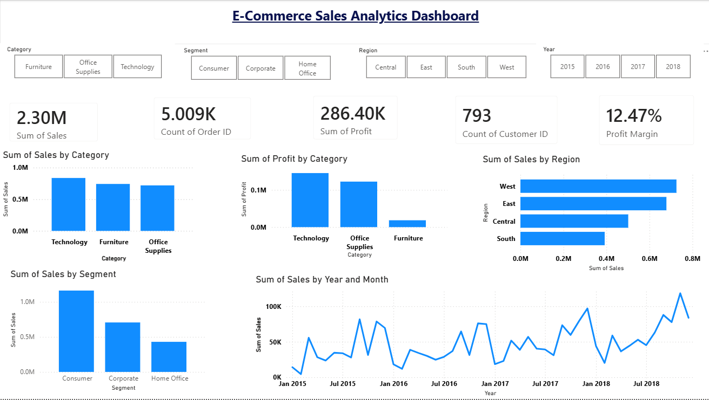

# E-Commerce Sales Analytics

## Project Overview

This project is based on an e-commerce sales dataset. I worked on the data to understand sales, profit, customers, products, categories, and regional performance.

I used Python and SQL for data cleaning and analysis and created an interactive Power BI dashboard to present the results in a simple and easy-to-understand way.

## Tools Used

- Python
- Pandas
- Matplotlib
- Seaborn
- SQL
- Oracle Database
- Power BI
- Excel
- Git & GitHub

## Dataset

The project uses the Sample Superstore dataset with 9,994 records and 21 columns.

The data contains information about:

- Orders
- Customers
- Products
- Categories
- Sales
- Quantity
- Discount
- Profit
- Regions
- Order Dates

## What I Did

### Data Cleaning

Used Python and Pandas to:

- Load the Excel dataset
- Check the data structure
- Check missing values
- Remove duplicate records
- Handle missing postal codes
- Create a cleaned CSV file

### Data Analysis

Analyzed the data to understand:

- Total sales
- Total profit
- Total orders
- Total customers
- Total quantity sold
- Average order value
- Profit margin
- Sales by category
- Profit by category
- Sales by sub-category
- Customer segments
- Regional performance
- Monthly sales trends

### SQL Analysis

Loaded the cleaned data into Oracle Database and used SQL queries to analyze:

- Overall sales and profit
- Category performance
- Sub-category performance
- Customer data
- Regional performance
- Monthly sales
- Product performance

### Power BI Dashboard

Created an interactive Power BI dashboard with:

- Total Sales
- Total Profit
- Total Orders
- Total Customers
- Profit Margin
- Sales by Category
- Sales by Segment
- Sales by Region
- Monthly Sales Trend
- Profit by Category

The dashboard also includes filters for Year, Region, Segment, and Category.

## Key Results

| KPI | Result |
|---|---:|
| Total Sales | $2.30M |
| Total Profit | $286.40K |
| Total Orders | 5,009 |
| Total Customers | 793 |
| Total Quantity Sold | 37,873 |
| Profit Margin | 12.47% |
| Average Order Value | $458.61 |

## Project Structure

```text
E-Commerce Sales/
│
├── data/
│   ├── cleaned_superstore.csv
│   └── Sample - Superstore.xlsx
│
├── powerbi/
│   └── Ecommerce_Sales_Analytics.pbix
│
├── python/
│   └── data_analysis.py
│
├── sql/
│   └── sales_analysis.sql
│
├── visualizations/
│   ├── monthly_sales_trend.png
│   ├── sales_by_customer_segment.png
│   └── sales_vs_profit_subcategory.png
│
├── README.md
└── superstore.ctl

What I Learned

Through this project, I gained practical experience in:

Data cleaning
Data analysis
Python and Pandas
SQL
Oracle Database
Data visualization
Power BI dashboard creation
Working with business data
Presenting data-driven insights
Conclusion

This project helped me understand the complete data analysis process, starting from raw data and data cleaning to SQL analysis and finally presenting the results through an interactive Power BI dashboard.


## Power BI Dashboard

